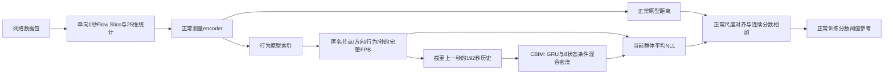

# 基于正常行为原型与历史条件强度的网络异常检测

本方法由正常原型偏离与**条件行为强度建模（Conditional Behavioral Intensity Modeling，CBIM）**两个分支构成。CBIM对应此前实现的192秒历史 BASE＋GRU Mass；其数学定义、模型参数和实验结果保持一致。K是行为原型数，Gaussian混合状态数固定为8。K=8与K=16均已在同五份捕获上评估；当前代码没有启用HN图消息或对比损失。

## 1. Overall：正常形态与群体强度的双重参照

视频物联网中，攻击与正常控制通信可能具有相近的单Flow形态，而正常通信的数量又会随活动状态变化。为同时刻画这两种变化，我们建立共享正常行为原型，并学习各行为群体在历史条件下的正常强度分布。每条Flow的异常性由其正常原型偏离及所属群体的强度偏离共同确定。

## 2. Traffic acquisition and snapshots：单向时间快照

将TCP/UDP通信按单向五元组和固定1秒窗口划分为Flow Slice，保留包量、字节量、包长、到达间隔及100ms活动统计组成的25维向量。反向通信保持独立。IP、端口和协议仅用于聚合；匿名IP相等关系用于后续活动归属，身份数值、端口类别、payload与攻击标签均不进入预测网络。

每秒构建匿名节点在发送、接收方向上的活动快照。相同正常行为下的Flow数、包数、字节数完整累计为FPB，重复通信真实增加群体强度。实际空白秒保留零活动，捕获开始前的padding不作为真实观测。包长沿用IPv4 `ip.len`、上限1500字节的既有口径。

## 3. Design I：共享行为参照与连续原型偏离

通过正常Flow的分组遮蔽预测学习 `25→64→32` 测量encoder，再在标准化表示空间拟合K个共享正常原型。原型由全部正常Flow统一学习，发送节点不参与原型划分。最近原型提供数量统计所需的行为归属，同时保留绝对距离以衡量对全部已知正常形态的偏离：

\[
z_i=\operatorname{Scale}_z(f_0(\operatorname{Scale}_x(x_i))),\qquad
d_{ik}=\frac{\lVert z_i-\mu_k\rVert_2^2}{w_k^2},\qquad
b_i=\arg\min_k d_{ik},\quad D_i=\min_k d_{ik}.
\]

其中，\(w_k\)是对应正常簇的径向距离中位数，并设数值下限；它不是Gaussian标准差。原型索引表示统计归属，不能据“存在最近原型”直接认定Flow正常。测试时距离可以持续增大，不截断，也不将远离原型的Flow从群体数量中删除。

这一设计建立了形态参照与数量统计之间的可追踪对应关系，并保留单Flow的额外区分证据。

## 4. Design II：条件行为强度建模（CBIM）

为刻画视频物联网通信规模随历史活动变化的规律，我们构建条件行为强度建模分支。该分支依据共享正常行为原型组织活动序列，在历史条件下预测当前行为群体的正常强度分布，并以观测强度的条件负对数密度衡量规模偏离。匿名节点用于确定活动归属和检索历史，预测网络在各匿名节点之间共享参数。

术语分别对应三个明确机制：**行为**是正常原型定义的通信形态归属，**强度**是完整Flow/Packet/Byte活动量，**条件建模**是仅依据过去活动、行为与方向预测正常分布。FPB是观测量，CBIM是学习这些观测量条件分布的模型分支。

对匿名节点 \(u\)、方向 \(d\)、行为 \(k\) 和秒 \(t\)，定义完整活动量：

\[
A_{u,d,k,t}=\sum_{i\in C_{u,d,k,t}}[1,n_i,v_i],
\]

其中 \(n_i,v_i\) 分别为Flow包数和字节数。一个节点每秒包含全部K个行为通道，共3K维。GRU读取截至 \(t-1\) 的最近192秒，经正常拟合的 `log1p＋Robust` 变换后形成64维历史表示；历史表示、行为one-hot及方向one-hot共同预测8个正常状态的混合权重：

\[
h_{u,d,t}=\operatorname{GRU}(\operatorname{Transform}_H(A_{u,d,<t})),\qquad
p_\theta(y\mid h,k,d)=\sum_{j=1}^{8}\pi_j(h,k,d)
\mathcal N(y;\mu_{j,k},\operatorname{diag}(\sigma_{j,k}^2)).
\]

当前活动量 \(y=\operatorname{Transform}_k(A_{u,d,k,t})\) 仅作为预测目标，不参与密度参数生成。状态均值限制在正常训练观测范围，标准差下限为0.15；状态内容在正常训练中学习，测试期间冻结。历史只改变正常状态的混合权重。

对于Flow \(i\)，取其发送节点对应群体的三维平均负对数密度：

\[
I_i=-\frac{1}{3}\log p_\theta(y_{u,\mathrm{send},b_i,t}\mid h_{u,\mathrm{send},t},b_i,\mathrm{send}).
\]

该设计用历史解释正常数量波动，同时保留突发重复、包量和字节量异常。这里学习的是变换空间的连续联合密度近似，不是整数计数的精确离散概率。测试冻结状态也不能保证历史污染消失。

## 5. Training objectives：仅正常通信的两阶段学习

全部12,518条正常Flow参与预处理、训练和正常重评分，不划分验证集。第一阶段用三组统计字段遮蔽及Huber损失训练测量encoder20轮：

\[
L_{\mathrm{measure}}=\mathbb E_{x,m}\frac{\sum_{j:m_j=1}\operatorname{Huber}(\hat x_j,x_j)}{\sum_j m_j}.
\]

随后固定测量encoder、行为原型和尺度，从未训练的检测器初始化联合优化GRU、混合权重网络及状态密度参数20轮：

\[
L_{\mathrm{CBIM}}=-\mathbb E_{(u,d,k,t)\in\mathcal G_{\mathrm{normal}}}
\frac13\log p_\theta(\operatorname{Transform}_k(A_{u,d,k,t})\mid h_{u,d,t},k,d).
\]

每轮先覆盖全部正常目标，再补充行为/10秒时间块平衡采样至至少100步；补采样不改变实际群体数量。使用seed42、Adam `1e-3`、batch256、梯度裁剪5，保存最后完整epoch。原型距离没有单独攻击监督或额外检测训练。

当前实现属于“固定行为计量＋历史密度联合学习”；测量encoder与CBIM尚未整体端到端训练。测试直接编码完整Flow，不执行遮蔽重建评分。

## 6. Deployment and anomaly decision：连续评分与正常阈值

使用全部正常Flow重评分的Q50/Q95对两支进行不截断尺度对齐，固定权重相加：

\[
Z_r(s)=\frac{s-Q_{50,r}}{\max(Q_{95,r}-Q_{50,r},10^{-6})},\qquad
S_i=Z_D(D_i)+Z_I(I_i).
\]

分数越高，越偏离正常参照。它不是攻击概率，可以为负。部署初始参考阈值取正常融合分数的 \(\tau=Q_{99}(S_{\mathrm{normal}})\)，以 \(S_i>\tau\) 标记异常；每秒完成评分后，再将实际活动加入历史。冷启动使用已有历史，缺少历史时采用零历史状态，不等待192秒，也不假定捕获开始必为正常。

当前实验用连续分数评价AUROC、average precision和插值EER。EER阈值依赖测试标签，仅用于离线评价，不能作为部署阈值。训练内Q99也不保证独立正常流量的误报率为1%；当前代码提供完整捕获的离线因果评分，未实现live采集、定时flush和报警服务。

## 可主张的设计贡献与当前边界

可集中表述为两个机制：**共享正常行为参照同时提供统计归属和连续形态偏离；以归属群体的完整FPB构建因果历史，学习正常强度的条件密度。** 它们共同检验“形态相近的通信，在其行为群体及历史背景下是否具有合理规模”。这些是本方案的设计贡献；普适创新性还需与相关工作比较验证。

同一发送节点、同一行为、同一秒的成员共享CBIM强度偏离项。原型距离只能补充形态差异，当前方法没有完成群体异常的成员归因；已经观察到OS Scan和LRDoS中的正常RTCP高分。不得将本方法表述为已解决上下文污染或能必然区分形态完全相同的正常与攻击Flow。

实现中的`mass_raw`、`Mass`历史结果标签及`LongMassModel`对应本文CBIM分支；原`M_i`在本文统一记为`I_i`。这些是同一计算过程的术语对应，既有文件接口和结果可继续复现。
